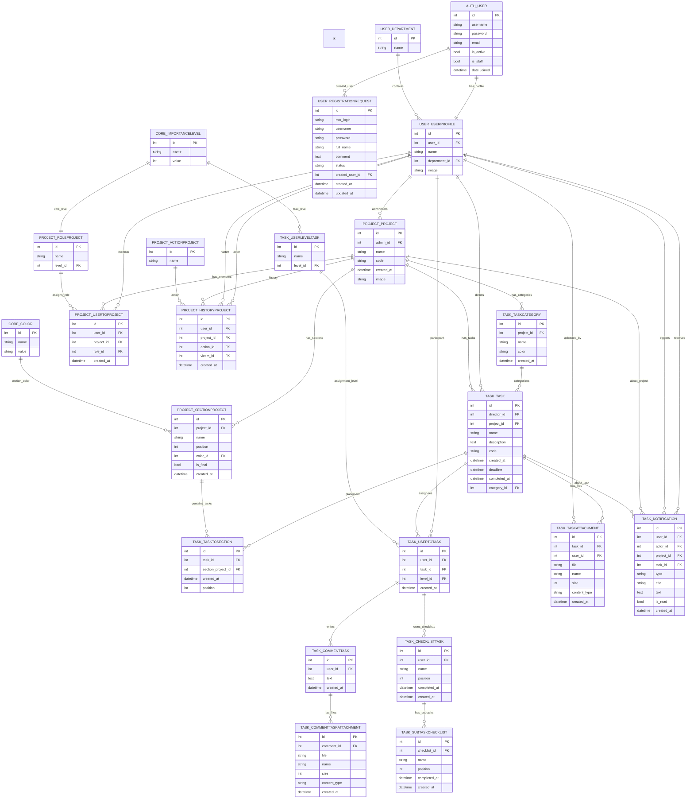

# Database ER Diagram

Source: Django models in `user`, `core`, `project`, and `task` apps.

## Notes

- Django creates `id` primary keys automatically for these models.
- `AUTH_USER` is Django's built-in `auth.User` table used by `UserProfile` and `RegistrationRequest`.
- `PROJECT_USERTOPROJECT` and `TASK_USERTOTASK` are join tables that store roles/levels for users.
- `TASK_TASKTOSECTION` stores kanban placement and order of tasks inside project sections.
- `TaskCategory` has a unique constraint on `(project, name)`.
